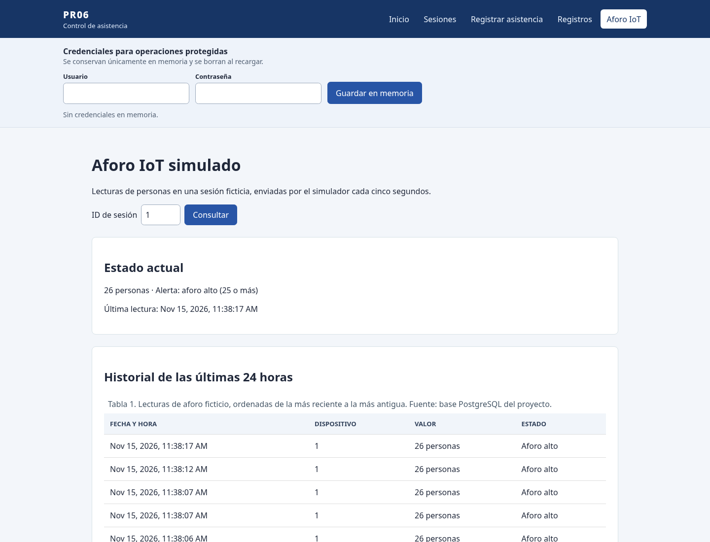
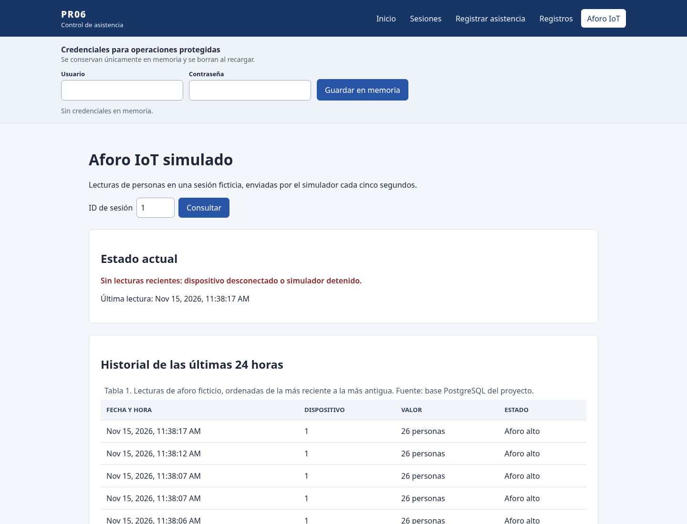

# P06 · Web 4.0 e IoT simulado: control de asistencia PR06

**Equipo DSW-E06 · DSW-19559 · Universidad Veracruzana · 15 de noviembre de 2026**

**Repositorio:** https://github.com/JeshuaBenitez/PR06_DSW-E06

**Actividad:** P06, módulo M05, rúbrica R06 (12 puntos).

## Resumen

Se amplió el mismo sistema PR06 de control de asistencia. Un simulador local publica cada cinco segundos el aforo ficticio de una sesión por HTTP POST. Spring Boot autentica, valida y persiste la lectura en PostgreSQL. Angular consulta cada cinco segundos las últimas 24 horas y muestra el valor actual, una alerta al llegar a 25 personas y un aviso si la última lectura tiene más de 30 segundos. La fuente está identificada como `SIMULADOR_HTTP`; no representa personas ni sensores reales.

## Alcance y relación con el proyecto previo

P02 y P03 registraron asistencia manual; P05 separó frontend y API. P06 añade un dato contextual de aforo asociado a `sesion` y al dispositivo ficticio `D001`. No se convierte automáticamente el aforo en registros individuales: una lectura agregada no identifica participantes. Se mantiene la base histórica y se incorpora la tabla `lectura_iot` mediante una migración independiente.

```text
simular.py (cada 5 s) → POST /api/telemetria → validación + HTTP Basic
                                         → lectura_iot (PostgreSQL)
Angular (cada 5 s)   → GET /api/telemetria?sesionId=1 → historial + alerta
```

**Figura 1. Flujo de P06. Fuente: elaboración del equipo a partir de la implementación.**

### Mensaje y reglas

**Tabla 1. Contrato de lectura simulada. Fuente: API P06.**

| Campo | Tipo y regla |
|---|---|
| `idDispositivo` | Entero positivo; dispositivo `ACTIVO` existente. |
| `idSesion` | Entero positivo; sesión existente. |
| `fechaHora` | ISO 8601 con zona; máximo 10 minutos de antigüedad y 1 minuto futuro. |
| `variable`, `unidad` | Exactamente `AFORO`, `personas`. |
| `valor` | Entero entre 0 y 100. |
| `origen` | Exactamente `SIMULADOR_HTTP`. |

El umbral de **25 personas** es una regla didáctica configurable mediante código, sin pretensión de representar la capacidad real del aula. El servicio devuelve `AFORO_ALTO` desde 25 y `NORMAL` por debajo. La interfaz calcula desconexión tras 30 segundos sin lectura nueva. La API limita la consulta a 100 filas y permite consultar una ventana de hasta 30 días; por defecto muestra 24 horas. La combinación dispositivo/instante es única para impedir repeticiones accidentales. Las consultas usan parámetros SQL, nunca concatenan entradas del usuario.

## Preparación reproducible

Requisitos: Java 11, Maven, Angular 16 con Node compatible, PostgreSQL y Python 3. El flujo principal se verificó con PostgreSQL 16.15 en un contenedor temporal aislado. Una ejecución anterior utilizó PostgreSQL 17.6; la evidencia actual corresponde a la versión 16 del perfil docente.

1. En una base **nueva**, cargar `schema.sql`, `data.sql` y después `docs/P06/01-telemetria.sql`. En una base P05 existente, aplicar únicamente la migración P06 una vez, después de identificar la base y respaldarla. No repetir los scripts iniciales sobre datos existentes.
2. Configurar las variables `DB_URL`, `DB_USER`, `DB_PASSWORD`, `API_BASIC_USER` y `API_BASIC_PASSWORD` según `.env.example`; no confirmar `.env` en Git.
3. Compilar y ejecutar `api-spring` con Java 11, instalar `frontend-angular` con `npm ci` y levantar Angular. La ruta del dashboard es `/telemetria`.
4. Ejecutar el simulador con las mismas credenciales de laboratorio que la API:

```bash
python3 iot-simulator/simular.py --sesion 1 --dispositivo 1
# Una lectura que reproduce la alerta:
python3 iot-simulator/simular.py --sesion 1 --valor 26 --una-vez
```

El simulador solo admite una URL local mediante `PR06_API_URL` (predeterminada `http://127.0.0.1:8080/api/telemetria`). Para Docker Compose, completar `.env` con valores locales y ejecutar `docker compose up -d --build`. La migración se carga al **crear un volumen nuevo**; un volumen P05 previo requiere aplicar el SQL por separado. `docker compose down` detiene sin borrar el volumen.

Para repetir el recorrido aislado completo con PostgreSQL 16 y Docker, ejecutar desde la raíz:

```bash
P06_DB_ENGINE=docker16 python3 scripts/verify-p06.py
```

El script crea un contenedor PostgreSQL temporal, carga el esquema y los datos ficticios, levanta API y Angular, comprueba respuestas y SQL, ejecuta el simulador durante varios ciclos, captura la alerta y la desconexión, y detiene los procesos y el contenedor que creó. No modifica una base preexistente. También admite el modo local `python3 scripts/verify-p06.py`; `PG_BIN` permite elegir la carpeta de binarios PostgreSQL de ese modo. Se requieren los puertos locales 55439, 8080 y 4200 libres.

## API y tratamiento de errores

**Tabla 2. Operaciones P06. Fuente: controladores y comprobación local.**

| Operación | Autorización | Resultado |
|---|---|---|
| `POST /api/telemetria` | HTTP Basic local | `201` con lectura y alerta; `401` sin clave; `400` para cuerpo inválido. |
| `GET /api/telemetria?sesionId=1` | Pública | `200` con historial descendente; `400` para parámetros inválidos. |

La clave no se registra ni se copia a la evidencia. El navegador solo consulta telemetría; las credenciales se usan para operaciones protegidas del sistema. No se necesita CORS porque Angular usa el proxy `/api`. HTTP Basic se limita al laboratorio local; para una red pública haría falta TLS y controles de identidad adicionales. Los errores devuelven un mensaje genérico sin trazas SQL.

## Evidencia y resultados

**Tabla 3. Índice de evidencia frente a R06. Fuente: ejecución local del 14 y 15 de noviembre de 2026.**

| Criterio R06 | Evidencia | Estado |
|---|---|---|
| Integración IoT, 3 pts | Salida real de `iot-simulator/simular.py` y POST `201` en `evidencia/P06_EQUIPO_DSW-E06-recorrido.json` | VERIFICADO |
| Dashboard, 3 pts | `evidencia/P06_EQUIPO_DSW-E06-dashboard.png`, compilación Angular | VERIFICADO |
| Historial PostgreSQL, 2 pts | PostgreSQL 16.15, cinco filas en SQL y GET con las mismas lecturas en JSON | VERIFICADO |
| Eventos o lectura periódica, 2 pts | Tres emisiones observadas del simulador, separadas por cinco segundos; polling Angular | VERIFICADO |
| Análisis y alertas, 2 pts | `AFORO_ALTO` para valor 26 y aviso de desconexión tras detener el simulador, ambos capturados | VERIFICADO |



**Figura 2. Dashboard de aforo IoT simulado con lectura de 26 personas, alerta e historial consultado desde PostgreSQL. Fuente: captura automatizada del navegador Chrome en la verificación aislada.**



**Figura 3. Aviso visible al pasar más de 30 segundos sin nuevas lecturas tras detener el simulador. Fuente: captura automatizada del navegador Chrome en la verificación aislada.**

**Tabla 4. Pruebas de esta ejecución. Fuente: consola y archivo de evidencia.**

| Comprobación | Resultado | Estado |
|---|---|---|
| Maven `test` | 44 pruebas, 0 fallos | VERIFICADO |
| Angular `npm test -- --watch=false --browsers=ChromeHeadless` | 29 pruebas, 0 fallos | VERIFICADO |
| Angular `npm run build` | Compilación terminada | VERIFICADO |
| API + PostgreSQL 16.15 + navegador | `401`, `400`, `201`, GET `200`, cinco filas SQL y dos capturas | VERIFICADO |
| Simulador CLI, lectura individual y continua | Una lectura con `--una-vez`; tres emisiones periódicas observadas en 12 segundos | VERIFICADO |
| Desconexión | Aviso capturado después de detener el simulador y superar los 30 segundos | VERIFICADO |

La prueba aislada genera una lectura HTTP de control y ejecuta el simulador CLI para generar otras cuatro. Las capturas muestran valores consultados por Angular, no datos añadidos manualmente en la página. La base de verificación se elimina al concluir el script. Las pruebas unitarias se ejecutaron con Java 21 instalado en el host, usando compilación objetivo Java 11; el recorrido de la API utilizó el ejecutable Java 11. Docker Compose completo no forma parte de este recorrido: se utilizó un contenedor PostgreSQL 16 aislado y procesos locales para API y Angular.

## Decisiones, límites y seguridad

Se eligió HTTP periódico frente a MQTT porque la rúbrica permite eventos o lectura periódica y el flujo local evita un broker adicional. La frecuencia de cinco segundos permite ver el cambio durante una demostración; no se afirma que sea apta para producción. Los datos son sintéticos y no contienen nombres, biometría, ubicación ni identidad individual. La validación ocurre en DTO, reglas de servicio y restricciones PostgreSQL. El historial se limita por sesión y tiempo. Una lectura enviada mientras no hay conectividad se pierde; el simulador informa el fallo y el siguiente ciclo reintenta con una lectura nueva. No hay cola ni garantía de entrega. La alerta es informativa; no acciona acceso físico ni toma decisiones sobre personas.

Se revisaron las restricciones OWASP básicas pertinentes: entrada validada, escritura autenticada, secretos externos, SQL parametrizado, CORS no requerido y errores sin detalles internos. El repositorio conserva dependencias docentes Angular 16/Spring Boot 2.7; `npm ci` informó vulnerabilidades de dependencias que requieren revisión separada antes de un despliegue público.

## Participación del equipo y trazabilidad

**Tabla 5. Distribución ilustrativa del trabajo para el reporte de equipo. Esta simulación no acredita contribuciones reales; cada integrante debe validarla antes de presentarla como autoría.**

| Integrante | Participación ilustrativa | Porcentaje ilustrativo |
|---|---|---:|
| HERNANDEZ RUIZ CRISTIAN SINOE | Integración, API, pruebas de extremo a extremo y documentación final | 50 % |
| HERNANDEZ BENITEZ JESHUA EDER | Revisión de frontend, despliegue local y evidencias | 25 % |
| RODRIGUEZ CASTILLO LUIS ANGEL | Simulador, datos de prueba y revisión de alertas | 25 % |

La trazabilidad verificable es el historial Git del repositorio enlazado en la portada, con el avance P05 integrado y un commit P06 específico. La atribución personal no se infiere de los commits ni de esta simulación. Para entregar en Eminus, adjuntar el DOCX o exportarlo a PDF y proporcionar el enlace directo al commit o repositorio; la plataforma institucional sigue siendo el medio oficial de entrega.

## Fuentes consultadas

- Guía P06, rúbrica R06, lectura M05 y banco C11 entregados por el docente en el paquete local de la actividad.
- Documentación del propio proyecto: `README.md`, `docs/P05/`, código y pruebas de P05/P06.

## Declaración de uso de inteligencia artificial

Para preparar P06 se utilizó un asistente de inteligencia artificial como apoyo sustancial para revisar los requisitos de la actividad, integrar el simulador de aforo con la API Spring Boot y el dashboard Angular, preparar pruebas, organizar la evidencia y redactar este informe. El incremento parte del proyecto P05 del repositorio y conserva el historial de las etapas anteriores.

Los resultados indicados como **VERIFICADO** proceden de comandos ejecutados durante esta preparación y de la evidencia incorporada al repositorio. La distribución de responsabilidades de la Tabla 5 es una simulación solicitada para el reporte, no una confirmación de aportaciones personales ni prueba de que cada integrante ejecutó las verificaciones descritas. Debe ser revisada y validada por el equipo antes de presentarse como declaración de autoría.

El uso del asistente no sustituye la revisión del código y del documento por los integrantes, la autoría responsable del equipo ni la verificación técnica del evaluador.
